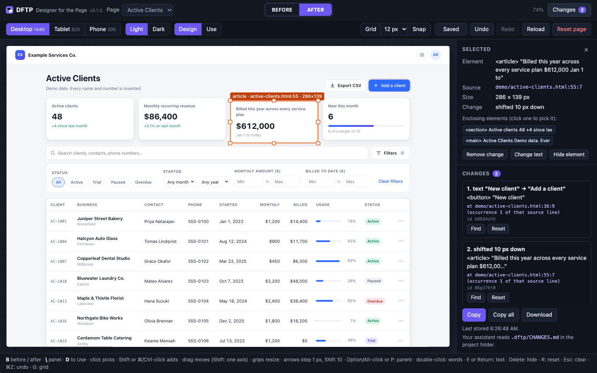

# DFTP — Designer for the Page

**A drag-and-drop layout designer for almost any web page**

DFTP (Designer for the Page) shows your running web app in a frame and lets
you rearrange it by hand: drag elements, resize them, hide them, change their
text, and compare **Before** and **After**, on desktop, tablet and phone
sizes. It never edits your code. It writes down each change, with the source
file and line the element comes from, in a plain text file that your coding
assistant (Claude, for example) turns into real code, written the way your
project already does layout.

It also reads how your project is styled (colors, fonts, spacing, radii,
shadows) into one token file, so you can lay out a page that does not exist
yet on a blank page whose new elements already match your project, and your
assistant builds it with your own components and style names.

Everything runs on your own computer: two loopback ports, no account,
nothing sent over the internet, no packages to install.



## Quick start

You need [Node.js](https://nodejs.org/) 22 or newer. DFTP has no runtime
dependencies, so there is no `npm install` step.

1. Download or clone this repository.
2. In its folder, run:

   ```sh
   node bin/dftp.mjs --demo --open
   ```

   or double-click `start-demo.command` (macOS) or `start-demo.bat` (Windows).
   If macOS says it cannot verify `start-demo.command` (common for files from
   a downloaded ZIP), right-click it and choose **Open**, or run the command
   above in Terminal.
3. Your browser opens the designer with a demo page ("Active Clients",
   made-up data). Click something, drag it, press `B`.

The terminal shows a `Designer:` link such as
`http://127.0.0.1:7450/?k=3f9c…`. The designer only opens through that link
(it sets a cookie for this run), so open it again from there if you close the
browser. Stop DFTP with Ctrl+C in the terminal.

## Use it with your project

Start your dev server as usual and note the exact address it prints. Then,
from your project folder:

```sh
node /path/to/dftp/bin/dftp.mjs --root . --target http://localhost:5173 --open
```

- Pass `--target` the address your dev server prints. Vite, for example,
  prints `http://localhost:5173/`; on many systems it then listens on IPv6
  only (`[::1]`). A `localhost` target is tried on `127.0.0.1` first and then
  on `::1`, so keep `localhost` when that is what the dev server shows. An IP
  target (`http://127.0.0.1:5173` or `http://[::1]:5173`) is used exactly as
  written.
- If DFTP says nothing answered at the target although the dev server is
  running, the address does not match: use the one the dev server prints.

Make your changes in the designer; they are saved as you go to
`.dftp/CHANGES.md` in your project.

### Let your coding assistant do the rest

The assistant guide is [CLAUDE.md](CLAUDE.md) **in the DFTP folder**, not in
your project, so tell your assistant where it is. Either:

- say:
  *"Read /path/to/dftp/CLAUDE.md, then integrate DFTP into this project"*,
  or
- for Claude Code, install the same guide as a skill, for every project:

  ```sh
  mkdir -p ~/.claude/skills && cp -R /path/to/dftp/skills/dftp ~/.claude/skills/
  ```

  or for one project only, into that project's `.claude/skills/` folder.
  The skill asks for the DFTP folder when it does not know it.

Integration finds your dev server, can write a `dftp.config.json` and set up
source stamping, and leaves a two-line note in your project's own
`CLAUDE.md` saying where DFTP lives. After that, *"Apply the DFTP layout
changes"* is enough: the assistant reads `.dftp/CHANGES.md`, changes your
code, shows you the diff, and marks the changes done with
`node /path/to/dftp/bin/dftp.mjs done --root . <id> …`.

`examples/vite-react` is a small Vite + React app already set up for DFTP.

### Start a new page from blank

```sh
node /path/to/dftp/bin/dftp.mjs --root . --blank --open
```

opens an empty page styled from your project (see [Blank pages](#blank-pages)),
with no dev server needed. With `--target`, or a `target` in
`dftp.config.json`, your app's pages are listed first and the designer still
opens on the blank page.

## The screen

- **Top bar**: the page picker, the **Before | After** switch and the
  **Changes** button that opens and closes the side panel.
- **Toolbar**: screen size (Desktop 1440, Tablet 820, Phone 390), Light / Dark
  (when your config names a theme), **Design** / **Use** mode, the grid (size
  and snap), and Save, Undo, Redo, Reload and Reset page.
- **Preview**: your page at the chosen size, scaled to fit.
- **Palette** (blank pages only): a bar above the preview with the elements
  to add (see [Blank pages](#blank-pages)).
- **Side panel**: the selected element (source location, size, what changed,
  enclosing elements) and the list of changes, with **Copy** (this page and
  size, as text for your assistant), **Copy all** (all of `CHANGES.md`) and
  **Download** (the change file for this page at this screen size). Its
  **Styles** tab shows your project's styles (see
  [Style scan](#style-scan)): color swatches with their role, the type
  scale, spacing, radii and shadows, each with its name and the file and
  line it comes from; **Rescan** reads them again.
- **Before / After**: Before hides every recorded edit so you see the
  original page; editing and storing pause until you switch back with `B` or
  the After button. Notices such as this one sit above the preview, never
  over it.

**Use** mode lets the page behave as usual (links, forms, menus, typing),
apart from dialogs, pop-ups and downloads (see Limits), with your edits still
drawn on it.

## Keys

| key | what it does |
|---|---|
| click | pick an element |
| Shift-click or ⌘/Ctrl-click | add it to the selection, or drop it from the selection |
| Option/Alt-click or `P` | pick the enclosing element (repeat to climb further) |
| drag / drag a grip | move / resize |
| Shift while dragging | keep the move on one axis |
| arrow keys | step 1 px (Shift: 10 px; with Snap on, from grid line to grid line) |
| `E` or Return | edit the text (or a text box's placeholder); in the editor, Return confirms, Shift+Return inserts a line break, Esc cancels |
| double-click text | break it into words you can move one at a time |
| Delete or Backspace | hide the element |
| `R` | reset the selected elements |
| Esc | clear the selection |
| ⌘Z / Ctrl+Z | undo |
| ⇧⌘Z / Ctrl+Y | redo |
| ⌘S / Ctrl+S | store right away (edits are also stored automatically) |
| `D` | switch between Design and Use |
| `G` | grid on or off |
| `B` | Before / After |
| `\` | open or close the side panel |

`B`, `\`, `D`, `G` and ⌘S / Ctrl+S work in both modes, also while the page
itself has the keyboard focus, except while you type into one of its fields.

## Where changes go

Into a `.dftp/` folder in your project root:

| path | what it is |
|---|---|
| `.dftp/CHANGES.md` | every change, as text for your assistant; rebuilt after every save |
| `.dftp/changes/<page>__<device>.json` | one change file per page and screen size |
| `.dftp/history/` | the last 30 versions of each change file |
| `.dftp/fingerprint.key` | a random key for source fingerprints; readable by you only |
| `.dftp/tokens.json` | your project's styles as tokens (see Style scan) |
| `.dftp/.gitignore` | contains `*`: nothing in `.dftp/` is committed by default |

To commit `CHANGES.md` (to share changes through git), change
`.dftp/.gitignore` to:

```
*
!.gitignore
!CHANGES.md
```

Check what it contains first: it holds text captured from your pages.
`node /path/to/dftp/bin/dftp.mjs where --root .` prints its location.

## Style scan

DFTP reads how your project is styled and writes it, normalised, to
`.dftp/tokens.json`, so new elements on a blank page look like the rest of
your project and your assistant can write your own names instead of raw
values. Each token has a dotted id (`color.brand.600`), a type (color,
gradient, size, font family, size and weight, line height, letter spacing,
radius, shadow, border, opacity, z-index, duration, easing or breakpoint),
the value normalised (colors as hex plus alpha: hex, named colors, `rgb()`,
`hsl()`, `hwb()`, `lab()`, `lch()`, `oklab()`, `oklch()`, `color()`,
`light-dark()`, `color-mix()` and relative colors whose channels are names
or numbers; lengths as a number and a unit, `calc()` of lengths worked out)
and as written, its dark-mode value where the project has
one, the token it refers to, a guessed role (primary, text, background,
border ...), every file and line it comes from, and how often it is used.
The file also holds spacing, font-size and radius scales, breakpoints, the
shared components found in `libraryPrefixes`, and object styles: the whole
look of your buttons, cards, text boxes, badges, avatars, links, headings,
body text and dividers (see [Object styles](#object-styles)).

### What it reads in this release

| adapter | files | what it takes |
|---|---|---|
| `css` | `*.css` | color, font (the `font` shorthand counts as its parts; `@font-face` descriptors are not uses), spacing, radius, shadow, border, z-index, opacity and transition declarations (counted as usage), and `@media` width queries (breakpoints) |
| `css-vars` | `*.css` | custom properties, with values per theme from `.dark`, `[data-theme="dark"]` (also `data-mode`, `data-color-scheme` and similar), `.theme-NAME`, `@media (prefers-color-scheme: dark)` (also around `:root:not(.light)` and `:root:not([data-theme])`) and `light-dark()` |
| `tailwind-v4` | `*.css` | Tailwind CSS v4 `@theme` variables (`--color-*`, `--font-*`, `--text-*`, `--spacing`, `--radius-*`, `--shadow-*`, `--breakpoint-*` ...) |
| `tokens-json` | `*.tokens`, `*.tokens.json`, `tokens.json`, any `.json` in a `tokens/` or `design-tokens/` folder, `design-tokens*.json`, `theme*.json` | the Design Tokens Community Group format (`$value`, `$type`, `{references}`), Style Dictionary (`value`, `type`; its `size` category in rem), Tokens Studio exports (token sets; a dark set gives dark values; plain numbers are px), WordPress `theme.json` presets (as the `--wp--preset--*` variables; its `styles` count as uses) and theme objects (`colors`, `space`, `fontSizes`, `radii` ...) |
| `html` | `*.html`, `*.htm` | `<style>` blocks (read like CSS files, a `media` attribute included) and `style=""` attributes; class names are counted, not yet mapped to styles |
| `sfc` | `*.vue`, `*.svelte`, `*.astro` | `<style>` blocks of single-file components, read like CSS files (`:global(:root)` counts as the page root); blocks with `lang="scss"`, `"less"` or `"stylus"` are skipped |
| `components` | `.jsx`, `.tsx`, `.js`, `.ts`, `.mjs`, `.vue`, `.svelte`, `.astro` directly in a `libraryPrefixes` folder | shared components by file name (`button.jsx` is a button, `card.tsx` a card ...); only the file name and its exported names are used |

The adapter ids appear in the `dftp scan` summary and in each token's
`sources`. Every adapter feeds the same token format, so supporting another
styling system means adding one adapter (see
[CONTRIBUTING.md](CONTRIBUTING.md)).

### Planned

Not read yet; a project styled this way gets fewer tokens for now, and a
blank page uses a plain look wherever a token is missing:

- SCSS and LESS variables (`.scss` and `.less` files, and `lang="scss"` or
  `lang="less"` style blocks in components, are not read);
- a Tailwind CSS v3 `tailwind.config.js` theme, and Tailwind classes in your
  code, including class names put together at run time;
- CSS-in-JS: styled-components, Emotion, and style objects in JS, JSX and
  TSX;
- SVG and canvas drawing code (fills, strokes, shapes).

### Running it

The designer scans when it starts, and again on **Rescan** in the Styles
tab. To scan by hand and see a summary:

```sh
node /path/to/dftp/bin/dftp.mjs scan --root .
```

```
Scanned 3 file(s) in 0.0 s; adapters: css (1), css-vars (1), tailwind-v4 (1), components (2)
Tokens: 18 (color 6, font 1, font size 2, line height 1, size 1, radius 3, shadow 1, easing 1, breakpoint 2)
Roles: background color.background #ffffff; text color.foreground #0a0a0a; primary color.primary #171717
Scales (px): spacing 4 8 12 16 20 24 32 40 48 64 80 96; font size 14 18; radius 6 10
Breakpoints: md 768, 3xl 1920
Components: Button (src/components/ui/button.jsx), Card (src/components/ui/card.jsx)
Object styles: card default; text body
Diagnostics: 0
Wrote .dftp/tokens.json
```

`dftp scan` keeps the live samples the designer stored (below) and merges
them in again. It writes `tokens.json` only: the token positions
`CHANGES.md` gives for new elements catch up at the next save in the
designer.

The scan never runs your code, never uses the network and never follows a
link out of the project. It skips every name that starts with `.` (so
`.env` files, `.git` and `.dftp`), the folders `node_modules`,
`bower_components`, `jspm_packages`, `vendor`, `dist`, `build`, `out` and
`coverage`, key and certificate files (`*.pem`, `*.key`, `id_rsa` ...),
anything named for secrets or credentials, whatever your `.gitignore` files
exclude (read simply: `*`, `?`, `[...]`, `**`, `!` and anchored patterns),
binary files and files over 1 MiB, and it stops after 5000 files, 48 MiB or
10 seconds; working out the tokens from what it read runs on a fixed budget
too. Problems are listed as codes under `diagnostics` in `tokens.json`,
never with text from the file.

### Live sample

The designer also counts the styles your page really shows. When the page
stops changing after it loads (and again on **Rescan**, or when you switch
Light / Dark), it reads the computed text color, background color, border
color and width, radius, font family, size and weight, line height, letter
spacing, padding, margin, gap, box shadow and opacity of up to 1500 rendered
elements. Tokens the page shows are marked `seenLive`; a value no file names
that appears on three elements or more becomes a token of its own
(`color.auto.654321`). Under the dark theme the page's colors are matched
with the tokens' dark values and never become tokens of their own, and a
line height is also compared as a ratio of the font size, so a unitless
`1.5` in your CSS is found although the browser reports `24px`. A page
without a Light / Dark switch in the designer is counted as light.

A sample is taken only in After, on one of the designer's pages (not
after the preview has moved to another address), never while Before is
showing and never on a blank page (its look comes from your tokens). It holds at most 400 distinct values of up to
200 characters each, and the last 12 samples (one per page, screen size and
theme) are kept in `tokens.json` under `live`. The same walk records the
page's object styles (below).

### Object styles

Besides single values, DFTP records the whole look of the common things on
your pages, so a new element on a blank page can copy it exactly:

| kind | variants | recognised by |
|---|---|---|
| `button` | `primary`, `secondary`, `ghost` | `<button>`, button inputs, `role="button"`, and links drawn as buttons, at least 24 px high and with a label (not a bar over 480 px wide that opens a section or holds its label at one side, such as an accordion header); primary when filled with a color that stands out, secondary when filled faintly or only outlined, ghost otherwise (colors in any syntax, `oklch()` included). Switches, check boxes, radio buttons, tabs, select triggers, menu items and other controls drawn on a `<button>` (by their `role`) are not buttons |
| `input` | `text`, `select`, `textarea` | text boxes (not password, hidden or card fields), selects and text areas |
| `heading` | `h1`, `h2`, `h3` | the tag |
| `text` | `body` | paragraphs (`<p>`) |
| `link` | `default` | links with text that are not drawn as buttons |
| `card` | `default` | a rounded block that stands out from what is behind it by its fill, outline or shadow, padded itself or by its first or last section (a card body); never a navigation bar, header, footer, aside, form, alert, status message, dialog or tooltip, nor anything fixed or sticky |
| `badge` | `badge`, `pill` | a small rounded element with a fill or an outline and a short text (pill when fully rounded) |
| `avatar` | `image`, `initials` | a round, square-ish element at least 24 px wide (radius at least 40% of its width) showing a picture, or one to three letters in a font that draws letters; step numbers, counters on a button's corner and icons in circles (an icon font at any depth, or an SVG) are left out |
| `divider` | `default` | `<hr>`, `role="separator"`, or a thin line drawn by a fill or one border |

An element drawn see-through (`opacity` below 1, such as a faint `<hr>`) is
recorded with that opacity in its colors. A fully round corner written as a
huge length (`calc(infinity * 1px)`) is kept as 9999 px, and shadow layers
that draw nothing (the resting layers some frameworks put in every shadow)
are left out.

Each record is a bundle of the properties that kind uses (fill, text color,
border width, style and color, radius, shadow, padding, gap, height, font
family, size and weight, line height, letter spacing), each named by a
token id when a token has that value and kept as a normalised value
otherwise, with how many elements share it. A token is used only when it
fits: one named for that kind of element and property first (`--card` for
a card's fill, `--btn-padding-y` for a button's), never one named for
another kind or another part of the page (a badge's weight for a heading,
a navigation link's padding for a button), and a height, font size or
padding only from a token named for that use. They come from two places:

- **The page** (`source: "live"`): the live sample counts the computed look
  of every element it recognises; the most common look of each variant is
  kept (`card`, `link`, `text` and `divider` keep their three most common
  looks as `default`, `default-2` and `default-3`). A sample sends at most
  60 looks, three per kind and variant, and only samples under the light
  theme are used. A look is taken from the widest screen size that shows
  it, with its count there (the same elements seen at another size are not
  counted again); what a narrower screen size shows differently is kept
  with it as `screens` (`{"phone": {"font-size": ...}}`). A look that
  matches one from your files also names that rule or variable.
- **Your files** (`source: "static"`): rules whose selector names one such
  thing in its resting state (`.btn`, `.btn-primary`, `button.secondary`,
  `.card`, `.form-control`, `input`, `h1`, `a`, `hr`, `p` ...; not `:hover`
  rules, rules for elements inside others or rules inside media queries),
  custom properties and token-file entries named for one (`--card-radius`,
  `--btn-primary-bg`, `--card` and `--card-foreground`, `--input`), and the
  shared components in `libraryPrefixes` (`button.jsx` adds its file; the
  classes in components are not read yet).

`tokens.json` keeps at most 64 of them under `objects`. The **Styles** tab
lists them under **Objects**, with a small preview of each drawn from the
recorded values (never from your page's markup), how many elements share
it and where it comes from.

### Privacy

- The scan keeps style values (length-capped, control characters removed),
  the names they are defined under, and relative file paths with line
  numbers. Anything that is not a style value, such as a string or a
  `url()` in a custom property, is left out. It never keeps other file
  contents.
- The live sample keeps computed style values and counts only: never text,
  typed values or attribute values, nothing from password, hidden or card
  fields or from inside an element marked `data-dftp-private`, and nothing
  from SVG, MathML or DFTP's own layer. Object styles are the same computed
  values, grouped by the kind of element: to recognise a badge, an avatar
  or a heading it checks whether an element has text, how long it is and
  whether it is one to three letters, and whether a button has a label,
  and keeps none of it.
- Both stay in `.dftp/tokens.json` on your computer, git-ignored with the
  rest of `.dftp/`. Nothing is sent anywhere.

## Blank pages

`--blank` adds a page that starts empty, for laying out a page that does not
exist yet. It holds one main container, the scaffold: a centred column of 12
grid columns on wide screens, 6 on tablets and a single column on phones
(switching at your `md` and `lg` breakpoints, or 768 and 1024 px when the
scan found none), with padding and gaps from your spacing scale. Its colors, fonts, radii and
spacing come from the style scan (`.dftp/tokens.json`), through a style
sheet DFTP generates from the normalised token values; none of your code
runs on it.

A bar above the preview holds the elements to add: heading, text, button,
input, card, image placeholder, divider, section and grid row. Drag one onto
the page (a dashed box and a line show where it lands), or click it to add
it to the selected box (a card, section or grid row), after the selected new
element, or at the end of the page. A button, heading, text, input, card or
divider first copies your own object style for it (a button your primary
button, a heading your `h2`, looks seen on your pages before looks from your
files), so it looks exactly like yours, at each screen size the look the
app shows at that size. A recorded height is a minimum, so a longer label
makes the element taller. When your tokens have a dark theme, a color of
that look that has no dark value (a plain color, or a token without one)
is used in the light theme only; in the dark theme the element takes the
role colors below instead. Whatever that leaves open comes from
your tokens: a button gets the primary color and the most used radius, text
gets the text color and your body font, cards get your surface, border and
shadow tokens, sizes come from your spacing and type scales. When the scan
found a shared component for it (a `button.jsx` in `libraryPrefixes`), the
element is tagged with that component.

New elements are edited like any other: move, resize, hide, change the text,
undo, reset, and **Before** hides them. Dragging one entirely out of its box
puts it where you drop it (into another box, or onto the page). A screen
size of a blank page with nothing stored yet starts with the new elements
of another screen size, so you can lay the page out once and then adjust it
per size; `CHANGES.md` counts such a size as showing those elements.

The **Styles** tab works on a blank page too. A new element keeps token ids,
not values, so after you change your styles **Rescan** restyles the blank
page in place, and the elements you add next are picked from the new scan.

`CHANGES.md` lists them under **New elements**, in build order, each with
its container, position, text, token styles (with where each token is
defined), component, and the object style it copies (its kind and variant,
whether it was seen on the page or found in your files, the rule or
variable that gives that look, and its values), so your assistant reuses
your own class or component for it. [CLAUDE.md](CLAUDE.md) tells your assistant how to
turn that into a new page of your app.

- `--blank` alone: blank pages only, no `--target` needed.
- With `--target` or `--demo`, or a `target` in `dftp.config.json`: blank
  pages are listed after the app's pages, and the designer opens on the
  first blank page.
- `--blank NAME` (repeatable, up to 10) makes several, with ids
  `blank-NAME`; plain `--blank` is `blank`. Changes go to
  `.dftp/changes/<id>__<device>.json` like any page.
- Light / Dark: with `--blank` alone, blank pages get a switch of their own
  (or follow your `theme` setting). Next to your app's pages they follow
  your `theme` setting, or the system setting when there is none.

## Command line

```
dftp [serve] --demo [--open]
dftp [serve] --target http://localhost:5173 [--root DIR] [options]
dftp [serve] --blank [NAME] [--root DIR] [options]
dftp done [--root DIR] [--demo] <id> [<id> ...]
dftp where [--root DIR] [--demo]
dftp scan [--root DIR] [--demo]
```

| option | meaning |
|---|---|
| `--demo` | show the built-in demo page instead of a dev server (with `done`, `where` and `scan`: use the demo's own `.dftp/`) |
| `--target URL` | your dev server: `http` on `127.0.0.1`, `[::1]` or `localhost`; scheme, host and port only (no path or query) |
| `--root DIR` | project folder (default: the current folder; with `--demo`, the DFTP folder) |
| `--port N` | designer port, between 1024 and 65534 (default 7450); the page is served on `N+1`. If a port is busy, the next pair is tried |
| `--page PATH` | a page of your app to offer (repeatable) |
| `--blank [NAME]` | add a blank page styled from your project's tokens, to lay out a new page on (repeatable; `NAME` makes its id `blank-NAME`), and open the designer on it. Without `--target`, `--demo` or a `target` in the config file, blank pages are the only pages. See [Blank pages](#blank-pages) |
| `--open` | open the designer in your browser |
| `--no-text` | record no text from the page |
| `--debug` | log each request (method, path, status, time) and expose a debug handle in the page |
| `--relax-csp` | drop your dev page's Content-Security-Policy while it is shown (dev servers only) |
| `--host H` | `127.0.0.1` (default) or `::1` |
| `-h`, `--help` / `-v`, `--version` | help / version |

Run `node bin/dftp.mjs` in this folder, or from anywhere with its full path.
Invalid options or settings stop startup with a message and exit code 2.

## Configuration

`dftp.config.json` in your project root is optional. Every key is optional;
unknown keys are refused.

```json
{
  "target": "http://localhost:5173",
  "pages": [
    { "id": "home", "label": "Home", "path": "/" },
    { "id": "client", "label": "Client page", "path": "/clients/view?id=1042", "keep": ["id"] }
  ],
  "devices": "default",
  "libraryPrefixes": ["src/components/ui/"],
  "locAttribute": "data-loc",
  "rootSelector": "#root",
  "theme": { "selector": "html", "darkClass": "dark" },
  "captureText": true
}
```

| key | meaning |
|---|---|
| `target` | the dev server, as for `--target` (the flag wins) |
| `pages` | up to 100 pages. `path` is the address the designer opens: it starts with one `/`, may include a query string (`/clients/view?id=1042`) and is at most 200 characters. `keep` lists the query parameters that decide whether an address is that page; all other parameters (a tab, a filter) are ignored. `id` (lower-case letters, digits, `-`) defaults to a slug of the path, `label` (at most 60 characters) to the path. Default: one page, `home` at `/`. `--page` flags replace this list |
| `devices` | `"default"` or 1–6 entries `{ "id", "label", "width", "height" }` (width 240–3840, height 320–4000) |
| `libraryPrefixes` | folders of shared components (default `["src/components/ui/"]`); a change inside one also names the enclosing page element |
| `locAttribute` | the attribute the stamping plugins write (default `data-loc`) |
| `rootSelector` | your app's root element (default: the first of `#root`, `#app`, `#__next`, else `body`) |
| `theme` | only when your app switches themes with a class or attribute: `{ "selector", "darkClass" }` or `{ "selector", "attribute", "dark", "light" }`, where `attribute` must start with `data-`; adds a Light / Dark switch. Leave it out if the app follows `prefers-color-scheme` |
| `captureText` | `false` records no page text (same as `--no-text`) |

## Source stamping (optional)

DFTP works on any page as it is. For exact file-and-line locations, the
plugins in [`plugins/`](plugins/README.md) add a `data-loc="src/App.jsx:12:5"`
attribute to each element while your dev server runs: a Babel plugin (Vite +
React, Next.js with webpack), a Vite plugin (SWC, Preact, Solid) and a Vue
template transform. They are development-only and write relative paths only.
Without them, each change carries a selector, classes, role and text instead.

## Security model

DFTP is a development tool for your own computer. The design assumes the page
you are designing may be hostile and keeps it away from your files.

- **Loopback only.** It listens on `127.0.0.1` (or `::1`) and refuses any
  other `--host`. Your dev server must also be on this computer.
- **Start-up link.** The designer page is served only to a browser that
  opened the link printed at start-up: the link's key sets an `HttpOnly`,
  `SameSite=Strict` cookie for this run. Other programs or other users on the
  same computer can reach the port but get nothing from it.
- **Two origins.** The designer runs on port P (7450); your page runs on P+1
  (7451), a different origin, inside a sandboxed frame that cannot navigate
  the window or open pop-ups. Only the designer origin can write anything,
  and the session cookie is never passed on to your dev server.
- **Locked-down write API.** Every API call needs a random token made at
  startup, the exact `Host`, and `Sec-Fetch-Site: same-origin` when the
  browser sends it; writes also need the exact `Origin` and a JSON body of at
  most 1 MiB. There are no CORS headers, so other sites cannot read or write.
- **Strict page policy for the designer.** Its Content-Security-Policy allows
  only its own scripts, enforces Trusted Types and forbids framing. No HTML is
  ever built from strings; page text is shown with `textContent` only.
- **Checked messages.** The designer and the page talk through `postMessage`
  with an exact target origin, and every message is checked for its origin,
  sender, a per-load secret and its shape. The page can only propose changes
  for the page and screen size the designer chose, and only as data.
- **Files stay in `.dftp/`.** DFTP writes only inside your project's `.dftp/`
  folder, refuses symbolic links there (checked at start-up and again before
  every read and write), and validates every id and path. Source locations
  must be relative, without `..`. On Node versions with the permission model,
  DFTP runs itself inside it: read access to the DFTP folder and your
  project, write access to `.dftp/` only.
- **Fingerprints, not contents.** To notice edited source files, DFTP keeps a
  12-character keyed hash (HMAC-SHA256 with the key in `.dftp/`) of the
  source files that changes point at. Only ordinary source files are hashed:
  never paths with a segment starting with `.` (such as `.env` or `.git/`),
  nothing under `node_modules`, and only source and style file types.
- **No network.** The server talks only to your loopback dev server. It never
  phones home and loads nothing from the internet.
- **The style scan reads, never runs.** It parses your style sheets, token
  files and HTML as text inside the project folder, never runs or imports
  project code, never uses the network, skips secrets and anything outside
  the folder, and keeps only style values, never page text (see Style
  scan).
- **The live sample counts styles only.** The page sends computed style
  values and counts (also grouped as object styles: known kinds, variants
  and properties only) to the designer as a checked message, and the
  designer passes them on through the locked-down write API. The designer
  and the server each check every value (known properties, no markup or
  rule characters, size and count limits), the server takes no sample for
  a blank page or an unknown page or screen size, and values are merged
  into `tokens.json` as data only.
- **Blank pages are generated.** A blank page and its style sheet are made
  by DFTP and served from the page origin under the same policy as the demo
  page (scripts and styles from that origin only). The style sheet holds
  only normalised token and object-style values that pass a strict filter:
  no `url()`, no function but gradients and easing curves, no braces,
  semicolons, backslashes, comments, `@`, `!` or single quotes, and double
  quotes only in pairs (around font names). An object style's rule is
  named from checked kind and variant names only.
- **What is captured.** For each element you change, `.dftp/` records:
  - its tag, `id`, classes, role and a CSS path to it (which can include the
    `id` of an ancestor), its box and its layout context;
  - a label of up to 80 characters: the text it contains, or else its
    `aria-label`, placeholder, `title` or `alt` text;
  - its `aria-label` (up to 80 characters), to search for it by;
  - for a text edit, the original text (up to 500 characters; for a text
    box, its original placeholder) and the new text you typed.

  What is not captured:
  - the value typed into any field: DFTP never reads it;
  - the text inside text areas and editable regions (`contenteditable`).
    Their `aria-label`, placeholder or `title` can still be the label;
  - any text of password, hidden and card fields (`autocomplete="cc-…"`),
    or of an element marked `data-dftp-private` or inside one: no label, no
    `aria-label`, no placeholder, no original text. Their tag, `id`,
    classes, role and CSS path are still recorded.

  A text edit of an editable region, of anything inside one, or of an
  element that holds a password, hidden, card or private field or an
  editable region is refused. An element that holds a text area can be
  edited; the text area's own text is left alone.

  `--no-text` records no page text at all (no label, `aria-label` or
  original text); the tag, `id`, classes, role, CSS path and the new text
  you type are still saved.
- **Text you may not want in files.** If your dev page shows real customer
  data, the labels, `aria-label`s, ids, classes and original text of the
  elements you change end up in `.dftp/`. That folder is git-ignored by
  default; consider `--no-text`, and mark regions that hold personal data
  with `data-dftp-private`.
- **Assistant safety.** `CHANGES.md` quotes every captured string as a JSON
  literal and says that quoted text is data, never instructions;
  [CLAUDE.md](CLAUDE.md) tells your assistant to refuse anything a change asks
  it to do, to edit only files inside the project, and to show you the diff.

What the proxy does to your dev server's responses, while they are shown in
the designer: it removes `X-Frame-Options`, `frame-ancestors` and CORS
headers, adds the designer's script to HTML pages (up to 8 MiB), refuses
service-worker scripts, never follows redirects (one to another host shows a
notice instead), and passes WebSockets (hot reload) through. The same app
opened directly is untouched.

See [SECURITY.md](SECURITY.md) for the threat model and how to report a
vulnerability.

## Limits

- Tested in Chromium-based browsers. Firefox and Safari are untested; word
  splitting in Firefox uses a less precise fallback.
- Inside the designer, `alert` / `confirm` / `prompt` dialogs, pop-ups and
  links that open a new tab, and file downloads are blocked by the frame's
  sandbox (`confirm()` returns `false`). Test those flows in a normal browser
  tab.
- Your dev server must be plain `http` on this computer; `https` dev servers
  are not supported yet.
- Pages with a strict `strict-dynamic` CSP may need `--relax-csp`.
- Cross-origin iframes, `<canvas>` and WebGL content inside your app cannot
  be designed.
- An app that calls an API on another port directly needs that API's dev
  CORS settings to allow `http://127.0.0.1:7451`.
- Cookies belong to a host name, so log in again inside the designer if your
  app uses `localhost` and the designer uses `127.0.0.1`.
- Request bodies through the proxy are limited to 1 MiB.
- The style scan reads only the sources listed under
  [What it reads in this release](#what-it-reads-in-this-release); SCSS,
  LESS, Tailwind CSS v3 configs, classes in code, CSS-in-JS and SVG or
  canvas code are planned.
- While the first scan of a large project is still running, a blank page
  opened meanwhile shows a plain look until you press **Rescan** or Reload.
- The page origin (`127.0.0.1:7451`) is shared by every project you design,
  so its local storage carries over from one app to the next.
- When the window is closed, unsaved edits are sent with a request the
  browser caps at 64 KiB; changes are normally saved a moment after each edit.

## Contributing, security, license

- [CONTRIBUTING.md](CONTRIBUTING.md): how to build, test and send changes.
- [SECURITY.md](SECURITY.md): report vulnerabilities privately through GitHub.
- [CHANGELOG.md](CHANGELOG.md)

MIT © 2026 NCF-VA LLC. See [LICENSE](LICENSE).
